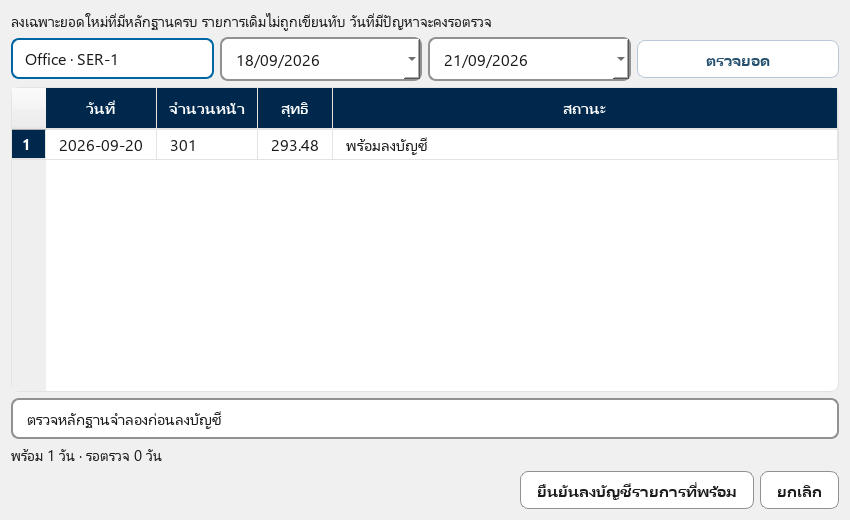
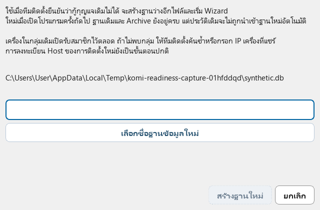

# KOMI Report 5.2.12 — คู่มือ source ระหว่างพัฒนา

เอกสารวันที่ 22 กันยายน 2569 ยังไม่ใช่คู่มือชุดติดตั้งหรือการอนุมัติ build
ภาพเป็นหน้าจอที่รันจาก source ด้วยข้อมูลจำลอง ไม่มีข้อมูลลูกค้าจริง
ใช้คู่มือนี้ตรวจส่วนที่พัฒนาแล้ว ส่วนที่ยังไม่เปิดใช้ระบุท้ายเอกสาร

**ขอบเขตรุ่นนี้:** ใช้ Host เดิม ไม่แก้ฝั่ง Host การเชื่อมสมาชิก Sync ต่อเนื่อง
และผู้อ่านร่วมยังเป็นงานของ 5.2.12 ระบบรับส่งผ่าน HTTPS และรายงานจากหลักฐานร่วม
มีขั้นตอนเข้ากลุ่มผ่าน Wizard และเริ่มสมาชิกใหม่เมื่อกู้กุญแจไม่ได้แล้วใน source
ต้นทางเปิดรับสมาชิกตลอดโดยอัตโนมัติ เครื่องใหม่เลือกกลุ่มใน Wizard แล้ว Sync ต่อเนื่องได้
ไม่ต้องมีคนกดเปิดอนุญาตซ้ำที่ต้นทาง และไม่มีเวลาจำกัด 5 นาทีสำหรับการเปิดรับสมาชิก
การลงบัญชีจากประวัติร่วมต้องตรวจและยืนยันก่อน ไม่เปลี่ยนรายการปิดแล้วอัตโนมัติ

## เพิ่มสมาชิกและตรวจยอดใหม่

1. ต้นทางเปิดรับสมาชิกไว้ตลอดเมื่อเริ่ม Desktop/Agent โดยอัตโนมัติ ต้องมีผลอ่าน Web และฐานที่ตรวจแล้วครบทุก Slot
2. เครื่องใหม่เลือกฐานใน Wizard ค้นหาหรือกรอก IP ตรวจบริษัท แล้วกด **เข้าร่วมและใช้การตั้งค่าร่วมกัน**
3. ทดสอบเครื่องพิมพ์และกรอกรหัสบนเครื่องใหม่เอง ตรวจค่าที่รับมา กดบันทึกและลงทะเบียนตามปกติ
4. หากเครือข่ายขาดช่วงหลังบันทึกแล้ว ระบบจะแสดงเข้ากลุ่มยังไม่ครบ ตรวจว่าต้นทางออนไลน์ แล้วกดค้นหาและเชื่อมต่อสมาชิกเดิมอีกครั้ง ไม่ต้องเปิดอนุญาตซ้ำ
5. เมื่อมีประวัติร่วม หน้าตรวจรอบบิลมีปุ่ม **ตรวจยอดจากประวัติร่วมก่อนลงบัญชี** เลือก Slot/วันที่ ตรวจยอด กรอกเหตุผล แล้วยืนยันรายการที่พร้อม

วันที่มีบัญชีหรือข้อมูลเดิมอยู่แล้วต้องตรวจฉบับแก้ไข การยืนยันครั้งใหม่ไม่เขียนทับรายการเดิม
ไม่สร้างเวลาหรือจำนวนครั้งอ่านปลอมสำหรับวันที่ขาด Web และการส่งหลักฐานไม่ใช่การลงบัญชีอัตโนมัติ
ดูขั้นตอนและเกณฑ์รับงานเครื่องจริงใน [คู่มือทดสอบ LAN](V5_2_12_LAN_TEST_RUNBOOK.md)

## การตั้งค่าเครือข่าย

ใน **ตั้งค่า → ขั้นสูง → การตั้งค่าเครือข่าย** ส่วน **สถานะการทำงานร่วมกัน**
แสดงงานอ่านบนคอมนี้และสถานะรับ/ส่งข้อมูลของสมาชิกที่เชื่อมต่อไว้
ถ้ายังไม่มีสมาชิกที่ยืนยันแล้ว จะบอกว่ายังไม่มีการเชื่อมต่อ ไม่สรุปว่าไม่มีคอมอื่นใน LAN

- **เสร็จครบล่าสุด** คือเวลาที่งานรับ/ส่งในรอบนั้นเสร็จครบ ไม่ใช่เวลาอ่านมิเตอร์ใหม่
- **Web รอยืนยันรับ** นับเฉพาะผลที่ยังไม่มีหลักฐานว่าคอมปลายทางบันทึกแล้ว
- **การตั้งค่า** แสดงว่าชุดค่าปัจจุบันยังรอยืนยันรับหรือไม่ การรับประวัติครบไม่ได้ยืนยันว่าได้รับค่าด้วย
- **ฉบับแก้ไขรอรับ** นับฉบับแก้ไขยอด ราคา และรายละเอียดที่ปลายทางยังไม่ยืนยันว่าบันทึกแล้ว
- แสดงจำนวนการตั้งค่ารอตรวจและ Slot ที่ฐานมิเตอร์ยังมีข้อขัดแย้ง
- กด **ตรวจสถานะอีกครั้ง** เพื่ออ่านสถานะบนคอมนี้ ปุ่มนี้ไม่ได้ค้นหา/จับคู่หรือยืนยันสิทธิ์สมาชิกใหม่
- เมื่อมีบริการผู้อ่านร่วม แสดงผู้ประสานงานและคอมที่อ่านจริงแยกกัน พร้อมสถานะงานและเวลาที่รับสถานะ
  ข้อมูลนี้เป็นสถานะล่าสุดที่เคยรับ ไม่ใช่หลักฐานว่าคอมยังออนไลน์ ปุ่มตรวจสถานะไม่สั่งอ่านหรือเลือกผู้อ่านใหม่

ภาพนี้ใช้สมาชิกและคิวจำลองเพื่อแสดงความหมายของแต่ละสถานะ การเชื่อมสมาชิกและ
ส่งข้อมูลผ่าน HTTPS ทดสอบด้วยฐานจำลอง ขั้นตอนด้านล่างใช้ทดสอบ source ก่อนตรวจแพ็กเกจจริง

**เมื่อการเชื่อมต่อมีปัญหา:** กด **ค้นหาและเชื่อมต่อสมาชิกเดิมอีกครั้ง** เพื่อค้นหาที่อยู่
และลองเชื่อมต่อสมาชิกที่เคยยืนยันแล้ว ปุ่มนี้ไม่เพิ่มสมาชิกใหม่และไม่เปลี่ยนสิทธิ์บริษัท
ปุ่มตรวจสถานะยังอ่านเฉพาะสถานะ ส่วนการค้นหาจะทำเมื่อกดปุ่มเชื่อมต่อโดยตรง
ถ้ากุญแจสมาชิกหายหรือไม่ตรงกับฐานข้อมูล ระบบแสดงสาเหตุและหยุดเชื่อมต่อไว้
ไม่สร้างกุญแจใหม่แทนสมาชิกเดิมโดยเงียบ ๆ การคืนเฉพาะฐานข้อมูลจึงอาจยังไม่พอ
เมื่อกู้กุญแจเดิมกลับมาได้แล้ว กดเชื่อมต่ออีกครั้งได้โดยไม่ต้องรีสตาร์ตโปรแกรม
กรณีกู้กุญแจเดิมไม่ได้ ให้ทีมติดตั้งใช้ปุ่ม **เริ่มสมาชิกใหม่โดยเก็บฐานเดิม**
เลือกชื่อฐานใหม่ สร้างฐาน แล้วกดใช้ฐานใหม่และปิดโปรแกรม เปิดครั้งถัดไปจะเริ่ม Wizard
ฐานและ Archive เดิมยังอยู่ การติดตั้งใหม่ต้องลงทะเบียนและเข้ากลุ่มใหม่ ไม่รับตัวตนเดิมมาใช้
หากค้นหากลุ่มไม่พบ ให้ทีมติดตั้งช่วยค้นหาหรือกรอก IP ของสมาชิกที่ออนไลน์

## ส่งออกรายงานเป็น Excel

ในหน้ารายงาน กด **ส่งออก Excel** ที่มุมขวาบน ปุ่มนี้ใช้ได้จากทุกแท็บ
เลือกช่วงวันที่แล้วเลือกที่บันทึกไฟล์ ไม่ต้องกดปุ่มซ้ำข้างตัวเลือกวันที่

ระหว่างส่งออก มี popup แสดงแถบความคืบหน้า เปอร์เซ็นต์ ขั้นตอนปัจจุบัน
จำนวนผู้ใช้ที่สร้างรายงานแล้ว และเวลาที่ใช้ เปอร์เซ็นต์เป็นความคืบหน้าตามขั้นตอน
ไม่ใช่การประมาณเวลาที่เหลือ ยังเปลี่ยนแท็บหรือใช้งานหน้าจอได้
ปุ่มส่งออกจะพักไว้จนกว่างานเดิมจบเพื่อป้องกันส่งออกซ้ำ กด **ยกเลิก**
เพื่อหยุดงานได้ ระบบหยุดเมื่อถึงจุดตรวจถัดไป จึงอาจไม่หยุดทันทีระหว่างบันทึกไฟล์
popup จะแสดง **กำลังยกเลิก** จนงานหยุดจริง การกดกากบาทหรือ Escape ใน popup ก็ขอยกเลิกเช่นกัน

เมื่อเสร็จระบบแจ้งตำแหน่งไฟล์ รายงานมี 6 แผ่นหลัก และแผ่นหมายเหตุเมื่อมีช่วงขาดข้อมูลหรือฉบับแก้ไข
ไฟล์ใช้ช่วงวันที่และฐานข้อมูลที่เลือกตอนเริ่มส่งออก หากยกเลิกหรือเกิดข้อผิดพลาด
ระบบไม่แทนไฟล์เดิมด้วยไฟล์ที่เขียนไม่ครบ หากแจ้งว่าเขียนไฟล์ไม่ได้ ให้ปิดไฟล์นั้น
ใน Excel หรือเลือกชื่อ/โฟลเดอร์ใหม่ แล้วส่งออกอีกครั้ง

### ส่งออกหลักฐาน Web และอ่านหมายเหตุ

ใน **ประวัติ Web และช่วงขาดการอ่าน** เลือกวันที่เริ่มต้น/สิ้นสุด มิเตอร์ และช่วงฐานมิเตอร์ แล้วกดเรียกดูข้อมูล
เลือกแถวในแท็บรายละเอียด แล้วกด **อ่านหมายเหตุเต็ม** หรือดับเบิลคลิก เพื่อเปิดข้อความทั้งหมดที่เลื่อนอ่านและคัดลอกได้
ปุ่มส่งออก Excel/PDF ทำงานเบื้องหลัง มี popup แสดงขั้นตอนและเวลาที่ใช้ กดยกเลิกได้ ระบบรอจุดหยุดที่ปลอดภัย
ก่อนแทนไฟล์ปลายทาง การยกเลิกหรือไฟล์ถูกล็อกจะไม่ทำลายไฟล์เดิม เมื่อย้ายช่วงวันที่ระหว่างส่งออก ไฟล์ยังใช้ข้อมูลที่เลือกตอนเริ่มงาน
กราฟที่มีเพียงผลอ่านครั้งแรกยังไม่แสดงยอดศูนย์ เพราะยังไม่มีช่วงอ่านให้คำนวณ ส่วนข้อมูลที่อ่านได้จริงเป็นศูนย์จะแสดงศูนย์

### ตรวจยอดและการตั้งค่า

การ์ดยอดเงินแสดงจำนวนเต็ม โดยจัดแถวใหม่ตามความกว้างหน้าต่าง ปุ่มสีจางและเส้นประยังใช้งานไม่ได้
กด Tab เพื่อเลื่อนไปตามปุ่ม กรอบสีฟ้าบอกตำแหน่ง keyboard focus
หน้าตรวจรอบบิลแสดงรายการเป็นหลัก เลือกแถวเพื่อเปิดรายละเอียด เครื่องพิมพ์ วันที่ และยอดก่อน/หลัง
หลักฐานทางเทคนิคอยู่ในส่วนที่กดขยายและคัดลอกได้ ต้องกรอกเหตุผลในช่องที่มีป้ายกำกับก่อนยืนยัน
ค่าที่บันทึกมีผลบนคอมนี้ การส่งต่อทำเมื่อเชื่อมสมาชิกต่อเนื่องแล้วและต้องตรวจสถานะยืนยันรับ
Wizard มีขั้นตอนเข้าร่วมสมาชิกต่อเนื่อง ส่วนปุ่ม Secondary Sync เดิมยังเป็นสิทธิ์รับค่าครั้งเดียว
การยืนยันรับค่าครั้งเดียวไม่ถือเป็นการอนุญาตสมาชิกใหม่
หากยังอ่าน Counter ไม่ได้ รายการที่เคยเลือกจะคงอยู่ การเอาทุกตัวออกต้องยืนยันอีกครั้ง

## ตรวจประวัติและช่วงขาดการอ่าน

1. เปิดส่วนตรวจสอบมิเตอร์ แล้วเลือก **ประวัติ Web และช่วงขาดการอ่าน**
2. เลือกเครื่องพิมพ์และช่วงวันที่ไม่เกิน 93 วัน กด **เรียกดูข้อมูล**
3. เลือกมิเตอร์รวม หรือมิเตอร์ของผู้ใช้ที่ต้องการดู
4. หากมีหลายฐานมิเตอร์ ให้เลือกช่วงฐานที่ต้องการดู ระบบแยกก่อน–หลังรีเซ็ตหรือเปลี่ยนเครื่อง
5. ตรวจกราฟรายวัน กราฟสะสมจริง และรายละเอียด/หมายเหตุ ก่อนส่งออก

ระบบเรียกผล Web ที่บันทึกแล้ว รวมไฟล์ Archive เฉพาะช่วงที่ขอ จุดแรกในช่วง
ที่เลือกเป็นฐานคำนวณของรายงานนี้ หากไม่มีหลักฐานจะแจ้งว่าไม่มีข้อมูล
ไฟล์หายหรืออ่านไม่ได้จะแจ้งข้อผิดพลาด ไม่แสดงยอดศูนย์เป็นรายงานสำเร็จ

ข้อมูลเดิมที่ยังไม่ผูกกับฐานที่ยืนยันจะแสดงเป็นกลุ่มแยก ไม่รวมอัตโนมัติกับฐานใหม่
Excel/PDF ระบุช่วงฐานที่เลือกด้วย การเลือกช่วงในหน้านี้เป็นการดูหลักฐานเท่านั้น
เมื่อยืนยันฐานเปลี่ยนเครื่องหรือ reset แล้ว ข้อมูลที่ยังไม่ปิดวันนับต่อจากฐานนั้น
พร้อมเก็บยอดก่อนหน้า ส่วนวันที่ปิด/รอตรวจคงหลักฐานเดิม ไม่ปลดรายการค้างโดยอัตโนมัติ

ตัวอย่างศุกร์ 1,000 → จันทร์ 1,301 และไม่มี Web เลยวันเสาร์–อาทิตย์:

- รายการช่วงมีผลต่าง 301 หน้า และวันลงยอดตามกติกาคือวันอาทิตย์
- กราฟแทนช่วงนั้นด้วยค่าเฉลี่ย 150.5 หน้าในแต่ละวัน โดยไม่บวก 301 ซ้ำอีกครั้ง
- สีส้มและคำว่า **ประมาณการ** ใช้แม้ผลเฉลี่ยลงตัวเป็นจำนวนเต็ม
- กราฟสะสมแสดงจุดอ่านจริง ใช้เส้นประเชื่อมช่วงขาด ไม่สร้างจุดมิเตอร์ปลอม
- หากเติมหลักฐานวันเสาร์ได้ภายหลัง กราฟคำนวณใหม่จากหลักฐานนั้นโดยยอดรวมไม่เพิ่มซ้ำ

หมายเหตุระบุช่วงต้น–ปลายและอธิบายว่าวันลงยอดไม่ได้ยืนยันว่าพิมพ์ทั้งหมดในวันนั้น
ช่วงคร่อมรอบบิล วันเปลี่ยนราคา หรือมิเตอร์ลดลง มีข้อความให้ตรวจสอบ

กด **ส่งออก Excel** เพื่อได้ขอบเขตข้อมูล จุดอ่านจริง ยอดตามช่วง และข้อมูลกราฟรายวัน
หรือ **ส่งออก PDF** เพื่อได้ตารางสรุปพร้อมหมายเหตุ รายงานตรวจหลักฐานนี้ยังไม่ปรับ
ledger หรือเอกสารเรียกเก็บเดิม และไม่ใช่การยืนยันฐานหลัง reset

## แก้การแบ่งยอดตามหลักฐาน Web

ในหน้าประวัติ Web เลือกฐาน Slot ที่ยืนยันแล้ว และช่วงวันที่ปิดแล้วไม่เกิน 93 วัน
กด **ตรวจแก้การแบ่งยอด** แล้ว **ตรวจการแบ่งยอด** เพื่อเทียบวันลงยอดและยอดสุทธิก่อนยืนยัน
ระบบตรวจตัวนับเครื่องทั้งหมดที่บัญชีเดิมใช้ ไม่ได้คิดเงินจากมิเตอร์ผู้ใช้หรือค่าเฉลี่ยในกราฟที่เลือกดู

ตัวอย่างยอด 301 หน้าที่ลงวันจันทร์ เมื่อหลักฐานยืนยันว่าครอบคลุมช่วงขาดตั้งแต่ศุกร์
ระบบเสนอให้ลงวันอาทิตย์ 301 และแก้วันจันทร์เป็น 0 ยอดรวมยังเป็น 301 หน้า
หากภายหลังได้ผล Web วันเสาร์และอาทิตย์ สามารถตรวจช่วงเดิมอีกครั้งเพื่อแบ่งตามหลักฐานจริง
โดยไม่เพิ่มยอดรวม ไม่สร้างจุดอ่านปลอมในวันที่จัดสรรยอด

ระบุเหตุผล แล้วกด **ยืนยันฉบับแก้ไขบนคอมนี้** ระบบเก็บบัญชีเดิมและเพิ่มรายการกลับยอดกับฉบับแก้ไข
รายงานใช้รายการล่าสุด พร้อมหมายเหตุและประวัติอ้างอิง Excel ของรายงานมีแผ่น **หมายเหตุฉบับแก้ไข**
การยกเลิกก่อนยืนยันไม่เปลี่ยนข้อมูล ถ้าหลักฐานเปลี่ยนระหว่างตรวจต้องตรวจใหม่
การบันทึกหลายวันเป็นชุดเดียว หากบันทึกไม่ครบจะย้อนคืนทั้งชุด

- ใช้ราคา หมวดราคา ส่วนลด และวันตัดรอบที่แช่แข็งไว้ในบัญชีเดิม การคำนวณราคาใหม่เป็นคนละขั้นตอน
- ยอดหน้าทั้งช่วงต้องตรงกับยอดเดิม ส่วนลดที่ปัดต่อวันอาจทำให้ยอดสุทธิต่างเป็นสตางค์ ซึ่งแสดงก่อนยืนยัน
- ถ้าช่วงคร่อมวันเปลี่ยนราคา/รอบบิล ฐานขัดกัน Serial ต่างกัน หรือหลักฐานต้น–ปลายไม่ครบ ระบบไม่แก้อัตโนมัติ
- รายการรอตรวจและรายการที่เคยปรับเงินด้วยมือยังต้องตรวจแยก ไม่ถูกเปลี่ยนเป็นหลักฐานที่ยืนยันแล้วโดยปุ่มนี้
- เปิด Archive เฉพาะช่วงที่ขอตรวจได้ แต่ไม่เขียนทับหลักฐานเก่า และยังไม่แก้รายละเอียดผู้ใช้/Raw Counter ที่จัดเก็บแล้ว
- ฉบับแก้ไขและคิวส่งบันทึกพร้อมกัน สมาชิกปลายทางตรวจหลักฐานและบัญชีเดิมของตนก่อนรับ
  ถ้าหลักฐานยังขาดหรือบัญชีต่างกัน รายการจะคงรอส่ง การส่งซ้ำไม่เพิ่มบัญชีซ้ำ
  ใช้ขั้นตอนเข้าร่วมกลุ่มด้านบนก่อนส่งข้อมูลระหว่างสมาชิก ส่วนงานแก้ Host แยกไว้เวอร์ชันหน้า

## ตรวจฐานมิเตอร์ของ Slot

ในหน้าตรวจสอบมิเตอร์ กด **ตรวจฐานมิเตอร์ของ Slot** เลือก Slot ระบุเหตุผล
แล้วกด **ตรวจค่า Web ล่าสุด** ระบบใช้ค่าที่อ่านและบันทึกแล้วจาก Serial ที่ตั้งไว้
ตรวจ Serial เดิม/ใหม่ ค่ามิเตอร์จากเครื่อง และยอดสะสม Slot ที่ยกมา ก่อนทำเครื่องหมาย
ยืนยันว่าตรวจแล้วและกด **ยืนยันฐานและบันทึกประวัติ**

ตัวอย่างยอด Slot เดิม 2,000 เปลี่ยนเป็นเครื่องใช้แล้วที่มิเตอร์ 50,000:
ฐานใหม่เก็บ 50,000 แต่ยอด Slot คง 2,000 เมื่ออ่าน 50,100 จึงเป็น 2,100
หากค่าอ่านหรือการตั้งค่าเปลี่ยนระหว่างตรวจ ต้องตรวจใหม่ก่อนยืนยัน

ฐานและประวัติการตั้งค่าจะบันทึกพร้อมกัน การยืนยันนี้ไม่อนุมัติยอดเรียกเก็บที่รอตรวจ
และยังไม่ยืนยันว่าเครื่องอื่นได้รับข้อมูลแล้ว ตรวจการยืนยันรับในหน้าการตั้งค่าเครือข่ายเมื่อเชื่อมสมาชิกต่อเนื่องแล้ว

## อ่านข้อมูลเดี๋ยวนี้

การกดอ่านเพิ่มจุดจริงโดยคงรอบอัตโนมัติเดิม เช่น รอบ 10:00/10:15/10:30
และอ่านมือสำเร็จ 10:10 จะเก็บทั้งสี่จุด หากมี Web กำลังอ่านอยู่จะใช้ผลรอบเดียวกัน
หากยังทำเฉพาะ SNMP ระบบรับคำขอ Web ต่อให้ครบ ไม่คืนข้อมูลเก่าเป็นผลใหม่
ส่วนนี้ทดสอบการประสานงานภายในคอมแล้ว และทดสอบ source จำลองสามคอมแยกฐาน:
เลือกผู้อ่านตามรอบอัตโนมัติ คงผู้ทำงานเดิม รับช่วงเมื่อเครื่องดับ และให้ผู้กดพร้อมกัน
รับผลจากงานเดียวกัน โดยใช้เวลาอ่านจริง ไม่แสดงข้อมูลเก่าเป็นผลสำเร็จใหม่
ขั้นตอนเปิดใช้กับหลายคอมต้องตรวจตามคู่มือทดสอบ LAN บนแพ็กเกจจริงอีกครั้ง
ผล source จึงยังไม่ถือว่าการทดสอบติดตั้งหรือใช้งานเครือข่ายจริงผ่าน

## ประวัติการตั้งค่าและราคา

ใน **การตั้งค่าเครือข่าย → ประวัติการตั้งค่าร่วม** เลือกรายการเพื่อดูค่าเดิม/ใหม่
การย้อนค่าจะเพิ่มประวัติใหม่ ไม่ลบรายการเดิม รองรับวันตัดรอบ ส่วนลด ตารางอ่าน
เวลาทำงาน รูปแบบราคา และราคาตามวันบังคับใช้

การย้อนราคาเปลี่ยนเฉพาะคู่ Slot/วันที่ที่อยู่ในรายการนั้น และคงราคาอื่นที่แก้ภายหลัง
ถ้าราคาเดียวกันถูกแก้ซ้ำแล้ว ระบบให้ตรวจรายการใหม่แทนการเขียนทับโดยไม่แจ้ง
ราคามีผลตามวันที่ ไม่ใช้ราคาวันนี้แทนทุกช่วงย้อนหลัง

## คำนวณราคาใหม่ตามช่วงวันที่

ในหน้าตรวจสอบยอดเรียกเก็บ เลือก **คำนวณใหม่ตามวันที่**:

1. เลือกช่วงวันที่ใช้งานและ Slot หากต้องการเปลี่ยนส่วนลดหรือจัดรอบบิลย้อนหลัง
   ให้เลือก **ใช้ส่วนลดปัจจุบัน** หรือ **จัดรอบบิลใหม่ตามวันตัดรอบปัจจุบัน**
   แล้วกด **ตรวจรายการที่เปลี่ยน** (เมื่อไม่เลือก จะคงส่วนลดและรอบบิลเดิม)
2. ตรวจยอดสุทธิ ส่วนลด และช่วงรอบบิลก่อน–หลัง รวมทั้งรายการที่ข้าม รายการรอตรวจ ปรับด้วยมือ หรือราคาไม่ครบ
   จะไม่ถูกเปลี่ยนเป็นยอดอัตโนมัติ
3. ระบุเหตุผล แล้วกด **ยืนยันรายการที่เปลี่ยนทั้งหมด** หรือ **ยกเลิก**

ระบบคงมิเตอร์และหมวดราคาของรายการเดิม สร้างรายการหักกลับและ
รายการแก้ไขพร้อมประวัติบนคอมนี้ การบันทึกทั้งชุดสำเร็จพร้อมกัน ถ้าล้มเหลวกลางชุด
จะไม่เหลือการแก้เพียงบางรายการ ถ้าราคา ส่วนลด วันตัดรอบ หรือหลักฐานเปลี่ยนหลังเปิด preview ให้ตรวจใหม่
การกดซ้ำของคำยืนยันเดิมไม่เพิ่มยอดซ้ำ ชุดใหญ่เกินขอบเขตจะให้เลือกช่วงสั้นลง

เมื่อเปลี่ยนรอบบิลของข้อมูลที่ Archive แล้ว ระบบจะตรวจไฟล์เดิมและปรับสรุปรายเดือน
ในครั้งเดียวกับรายการแก้ไข โดยเก็บไฟล์ Archive เดิมไว้ หากอ่านไฟล์ไม่ได้จะไม่บันทึก
ระหว่างกำลังบันทึกให้รอผลก่อนปิดหน้าต่าง การแก้ไขอยู่บนคอมเครื่องนี้พร้อมคิวส่ง
การส่งให้สมาชิกใช้งานผ่านระบบสมาชิกต่อเนื่อง เมื่อ Wizard ยืนยันการเข้าร่วมครบแล้ว

## ตรวจยอด Hold หรือปรับเงินที่ปิดวันแล้ว

ในหน้าตรวจสอบรอบบิล เลือกรายการล่าสุดของวันที่ปิดแล้ว แล้วกด **ตรวจและแก้ยอด**
ตรวจเครื่องพิมพ์ Serial วันที่ รอบบิล ยอดเดิม และหลักฐาน จากนั้นกรอกยอดก่อนส่วนลด/ยอดสุทธิ
ระบุเหตุผลและหลักฐานที่ใช้ตรวจ แล้วเลือกช่องรับทราบก่อนกด **ยืนยันฉบับแก้ไข**
กด **ยกเลิก** ได้ก่อนยืนยันโดยไม่มีการเปลี่ยนยอด

ยอดที่กรอกเป็นจำนวนเงินที่ผู้ตรวจอนุมัติ ไม่ได้เปลี่ยนมิเตอร์เดิมให้เป็นข้อมูลที่ผ่านการยืนยัน
ต้นฉบับ คำเตือน และเหตุผลยังอยู่ รายการ Hold เดิมแสดงว่ามีฉบับอนุมัติแล้ว
ถ้ามีคนเปลี่ยนบัญชีหรือหลักฐานหลังเปิดหน้าตรวจ ต้องเปิดตรวจใหม่ การส่งคำยืนยันเดิมซ้ำไม่เพิ่มยอด

## แก้รายละเอียดผู้ใช้และ Raw Counter ย้อนหลัง

เปิด **ประวัติ Web และช่วงขาดการอ่าน** เลือก Slot ช่วงวันที่ไม่เกิน 93 วัน ตัวนับ
และฐานมิเตอร์ที่ยืนยันแล้ว จากนั้นกด **ตรวจแก้รายละเอียด** → **ตรวจรายละเอียดกับหลักฐาน**
ตรวจยอดรายวันก่อน–หลัง ระบุเหตุผล แล้วจึงยืนยัน ตัวนับยอดรวมผู้ใช้/บัญชีจะปรับทั้ง
รายละเอียดผู้ใช้และ Raw ของตัวนับนั้นในครั้งเดียว ส่วนยอดเงินตรวจแก้ผ่านหน้ารอบบิลแยกกัน

ระบบเก็บต้นฉบับและเพิ่มฉบับแก้ไข ทั้งข้อมูลในฐานหลักและที่อยู่ใน Archive
วันที่จัดสรรยอดโดยไม่มีการอ่านจริงจะไม่มีค่าเปิด/ปิดหรือเวลาอ่านที่สร้างขึ้น
หน้ารายงานและ Excel มีหมายเหตุ เมื่อเติมประวัติจริงภายหลังสามารถตรวจและออกฉบับใหม่ได้
ยอดรายเดือนใช้สรุปในฐานหลัก ไม่เปิดรายละเอียดเก่าทุกครั้ง หากหลักฐานไม่ครบ/ขัดแย้ง
หรือ Archive เสีย จะไม่บันทึกการแก้เพียงบางส่วน

## Archive และการสำรองข้อมูล

เมื่อเปิดส่วนนี้ โปรแกรมจะแสดง **กำลังตรวจจำนวนข้อมูลเก่า** ระหว่างรอสามารถ
เปลี่ยนหน้าได้ จำนวนจะแสดงเมื่ออ่านสำเร็จ ถ้าอ่านไม่สำเร็จให้กด **ตรวจจำนวนใหม่**
เพื่อทดลองอีกครั้ง ปุ่มจัดเก็บจะใช้ได้เมื่อทราบจำนวนแล้ว

ผล Web รายรอบและรายละเอียดรายวันของผู้ใช้/Raw Counter ที่เกิน 12 เดือนจัดเก็บแบบ
บีบอัดแยกตามปี ระบบทำเมื่อว่างหลังเริ่ม runtime โดยให้การอ่านเครื่องพิมพ์ทำก่อน
หรือสั่งได้ใน **ตั้งค่า → ขั้นสูง → จัดเก็บรายละเอียดประวัติเก่า**

- ปุ่ม **หยุดหลังจบชุดนี้** รอให้ชุดปัจจุบันตรวจและบันทึกเสร็จก่อนหยุด
- ระบบตรวจข้อมูลและไฟล์ก่อนย้าย payload ออกจากฐานหลัก ประวัติและคิวที่ยังรอส่งยังอยู่ครบ
- สำรองผ่านปุ่มของโปรแกรมจะคัดลอกไฟล์ Archive ที่ฐานนั้นอ้างอิง พร้อมตรวจ checksum
- เมื่อนำสำเนาไปเครื่องอื่น ต้องนำไฟล์ฐานข้อมูลและโฟลเดอร์ **archives** ที่อยู่ข้างกันไปด้วย
- ถ้า Archive หาย/เสียหรือชื่อไฟล์ปลายทางชนกับข้อมูลอื่น ระบบหยุดการสำรอง/กู้คืนและเก็บต้นฉบับไว้
- พื้นที่ว่างในฐานข้อมูลนำกลับมาใช้ได้ ขนาดไฟล์บนดิสก์อาจไม่ลดทันที
- การล้างข้อมูลใช้งานไม่ลบไฟล์ Archive เก่าหรือสำเนาสำรองบนดิสก์อัตโนมัติ

หากประวัติ Web เก่าถูกจัดเก็บก่อนมีสรุปรายงานร่วม กด **เติมรายงานจากประวัติที่จัดเก็บแล้ว**
เพื่ออ่านไฟล์เก่าและเติมสรุปเฉพาะส่วนที่ขาด การเปิดหน้านี้เฉย ๆ ไม่เริ่มอ่านไฟล์ Archive
งานทำเบื้องหลัง กด **หยุดหลังจบชุดนี้** ได้ และกดเติมอีกครั้งเพื่อทำต่อโดยไม่เพิ่มยอดซ้ำ
เมื่อเสร็จ รีเฟรชหน้ารายงาน หากแจ้งว่าเติมไม่สำเร็จ ให้ตรวจไฟล์ **archives** และสิทธิ์อ่านแล้วลองใหม่
รายการที่เสร็จแล้วคงอยู่ หลักฐานและบัญชีเดิมไม่ถูกเขียนทับ

รายงาน Users/Raw/Usage และ Excel ใช้หลักฐานร่วมที่เติมแล้วได้ แม้คอมนี้ไม่ได้เป็นผู้อ่านเครื่องพิมพ์
ตารางลงยอดช่วงขาดข้อมูลวันก่อนกลับมาอ่าน พร้อมหมายเหตุและไม่สร้างเวลาอ่านปลอม
กราฟเฉลี่ยเฉพาะวันที่ไม่มี Web โดยแสดงทศนิยมและคำว่าประมาณการ เช่น 301 หน้าเป็น 150.5 สองวัน
Excel ใช้ยอดจัดสรรจริง 301 หน้า ไม่ใช้ค่าเฉลี่ยในกราฟแทนยอดจริง
ยอดที่ยังไม่ลงบัญชีแสดงเป็นยอดชั่วคราว; หากหลักฐานราคา/ตัวนับไม่ครบ จะไม่สร้างยอดเงินประมาณการ
วันที่ปิดยอดแล้วรักษาบัญชีเดิม หากหลักฐานใหม่ต่างกันต้องใช้ขั้นตอนตรวจฉบับแก้ไข

รายงานรายเดือนใช้สรุปผู้ใช้ในฐานหลัก ไม่ต้องเปิดไฟล์เก่า เมื่อเลือกดูรายละเอียด
หรือช่วงวันที่เฉพาะ ระบบจึงเปิด Archive ที่เกี่ยวข้อง ค่าตั้งต้น ค่าล่าสุด และรายการ
ที่ยังรอตรวจมิเตอร์ยังอยู่ในฐานหลักเพื่ออ่านต่อได้ บัญชียอดเรียกเก็บเดิมยังคงอยู่

วันที่ย้ายเข้า Archive แล้วจะไม่รับการเขียนซ้ำที่ทำให้ยอดซ้อน หากต้องแก้หลักฐานเก่า
ต้องใช้กระบวนการฉบับแก้ไข รายการบัญชีเครื่องที่ยอดเดิมและหลักฐานครบใช้ขั้นตอน
แก้การแบ่งยอดด้านบนได้ รายละเอียดผู้ใช้/Raw Counter ใช้ขั้นตอนตรวจแก้รายละเอียด
การคำนวณราคาใหม่ของ ledger เดิมยังทำได้ เพราะหลักฐานมิเตอร์รายวันของเครื่องไม่ได้ย้ายออก

## งานที่ยังไม่ครบในรุ่นนี้และการตรวจหลัง build

- Wizard เข้าร่วมกลุ่ม ฐานใหม่หลังสูญกุญแจ และการตรวจยอดประวัติร่วมมีใน source แล้ว
  ผล HTTPS/คิวส่งจากฐานจำลองยังไม่ใช่ผลติดตั้งจริงหรือหลักฐานสิทธิ์บริษัทจาก Host
- ทีมติดตั้งรับผิดชอบกรณีติดตั้งใหม่ไม่พบกลุ่มเดิมหรือ LAN แยกขาดกัน
- ตรวจเปลี่ยนเครื่อง/reset ฉบับแก้ไข และผู้อ่านร่วมบนแพ็กเกจจริงตามคู่มือทดสอบ LAN
- หลัง build: ตรวจ Agent ของแพ็กเกจจริง รวมบริการลูกภายใต้ workload และสองคอมจริง
- งานที่ติด Host รวม trust path ของการลงทะเบียน/ใบรับรอง เก็บไว้เวอร์ชันหน้า
- ภาพการติดตั้งและการใช้งานสองคอมจริงหลัง build ใช้ตรวจคู่มือฉบับส่งมอบอีกครั้ง

## English workflow reference

This source guide documents version 5.2.12 before installer testing. All screenshots use synthetic data.
The source Wizard now joins continuous members with joining enabled persistently on the source and group selection in the recipient Wizard, preserving settings and meter-baseline history. Permanently lost keys use a new installation in a separate database, keeping the old database and archives. Shared-history accounting requires explicit review. Package installation and physical PC + VM105 acceptance remain a separate test stage; these are not claimed as passed.
Each computer keeps its own registration identity. A local save is not a delivery acknowledgement.

- **Setup:** select the company, test the chosen printers and assign slots, review dated prices and billing day, then confirm the summary. Joining stays enabled on the sending computer without repeated approval. Search again or enter its IP if discovery finds nothing.
- **Overview and reports:** select a date range and review full totals. Cards reflow on smaller windows. A dash means data is unavailable; a measured zero remains zero. Single-point charts use bars. Numbered user labels correspond to the detailed table; hover for the full name.
- **Reports Excel:** use the single Export Excel button in the Reports header. Choose dates and a destination. Progress shows the stage and elapsed time, not a promised time remaining. You can keep using the report. Cancel, Escape or closing the popup requests cancellation and preserves the previous destination file.
- **Web evidence:** choose the printer, start/end dates, counter and meter epoch, then load saved evidence. The first reading is a baseline. Daily estimates divide the missing-period difference over days without any Web reading; 301 pages across two days displays 150.5 per day. Estimated graph values are not added again to billing.
- **Full remarks and export:** select a remarks row and use Read full remarks, or double-click it. Both Excel and PDF export in the background with progress and cancellation. If a destination file is open, close it or choose a different filename and retry. The file uses the selection captured when export began.
- **Billing review:** select a row, review its printer, dates, amounts and hold reason. Expand Technical details only when needed; Copy evidence keeps the complete original text. Enter the required reason before confirming. Original entries are retained. Reviewing or confirming a meter baseline does not silently approve earlier invoices.
- **Settings:** General, Automation, Status and history, and Advanced use the same navigation. Small windows scroll rather than expanding beyond the available area. Initial setup access and read-only Web reports are separate controls.
- **Reconnect:** use **Find and reconnect existing members** to retry discovery and connections for already approved members. **Check status again** only reads status. Missing or mismatched keys show a specific recovery message; the peer loader does not replace the old identity silently. Restoring a database alone may not restore OS-vault keys. After restoring the original keys, retry without restarting. If the original keys cannot be restored, choose Start a new member and keep the old database, create a separate file, switch and relaunch the Wizard. The installation team handles group discovery and selection; normal Host registration still applies.
- **Pinned counters:** saved choices remain visible and selected when a printer has not supplied counters. Uncheck unwanted entries. Removing all saved entries requires explicit confirmation.
- **Background agent:** closing the desktop window leaves the agent running in the system tray. Use the agent's Exit action to stop it completely. Opening the desktop again reconnects to the local data.
- **Archive:** data older than a year can be archived. Monthly summaries remain available; detailed historical Web evidence is loaded only when requested. Keep the archive with its database when making a backup.
- **Fill older reports:** in Archive settings, choose **Fill reports from archived history** to index previously archived Web evidence. Opening the page only reads counts. The job runs in the background; **Stop after this batch** preserves completed work and retry resumes without duplicate usage. Refresh reports afterward. Missing files or read permissions require correction and retry; original evidence and closed accounts are preserved.
- **Shared reports:** Users, Raw and Usage reports and Excel can show received Web evidence without a local reading cache. The table allocates a missing-period total to the day before readings resume and shows a remark, with no invented reading time. Charts average only days without Web evidence and mark estimates, including decimals. Excel retains actual allocated totals. Unposted usage is provisional; closed billing remains unchanged until an explicit reviewed correction.

## ภาพหน้าจอปัจจุบัน / Current screen reference

การโหลดรายงานในรุ่นนี้: Overview แสดงสถานะโหลดและมีปุ่ม **ลองโหลดอีกครั้ง**
เมื่ออ่านไม่สำเร็จ ส่วนรายงานที่กำลังเปลี่ยนช่วงจะแจ้งว่าตัวเลขเดิมเป็นของช่วงใด
เปลี่ยนแท็บหรือช่วงใหม่ได้ขณะรอ โปรแกรมจะแสดงผลของช่วงล่าสุดที่เลือก
หน้าตรวจสอบรอบบิลเริ่มอ่านเมื่อเปิดหน้านั้น และใช้ **Refresh** เพื่อลองใหม่ได้

Loading reports: Overview shows loading and offers **Retry loading** after a failed
read. When changing report dates, the notice identifies the previously displayed
period until the new one is ready. You may change tabs or dates while waiting.
Billing history loads when its page opens; use **Refresh** to retry. Archive counts
load when the section opens; **Refresh counts** retries without starting archival.

ภาพไทยและอังกฤษด้านล่างใช้ไฟล์ชุดเดียวกับคู่มือในแอป ข้อมูลบริษัท เครื่องพิมพ์ และผู้ใช้เป็นข้อมูลจำลอง
The Thai and English screenshots below are shared with the in-app guide. Names are fixture data and are not translated.

### 1. บริษัท / Company

### 2. เครื่องพิมพ์ / Printers

### 3. ราคา / Pricing

### 4. ยืนยันติดตั้ง / Setup review

### 5. ภาพรวม / Overview

### 6. อุปกรณ์ / Devices

### 7. รายงาน / Reports

### 8. การใช้งาน / Usage

### 9. ข้อมูลเดิม / Legacy

### 10. การตั้งค่า / Settings

### 11. เครือข่าย / Network

### 12. ขั้นสูง / Advanced

### 13. คู่มือ / Manual

