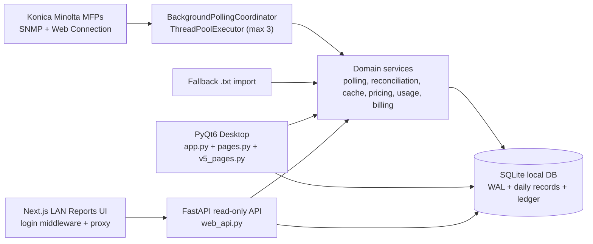
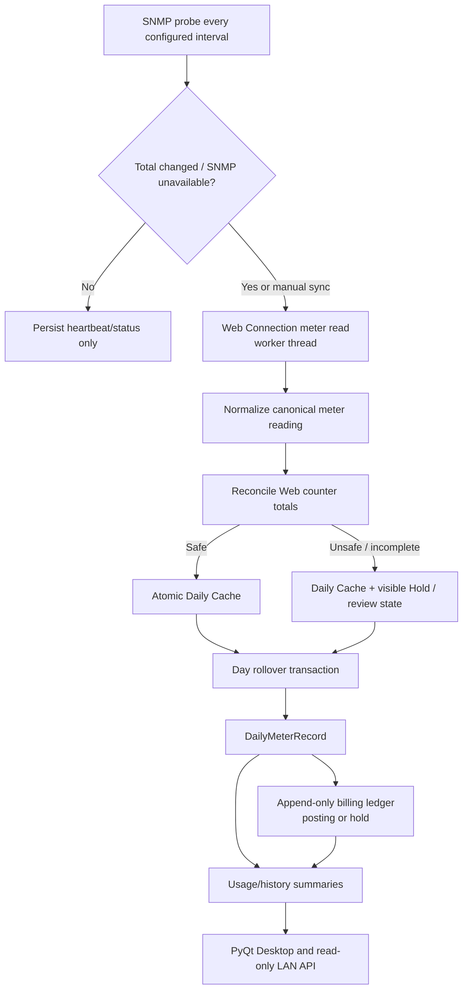

# KOMI Report V5 — Production Readiness Review

**Review date:** 2026-08-05  
**Scope:** source tree, Desktop PyQt6 app, local SQLite, LAN Web Edition, release scripts and automated tests.  
**Decision:** **Not production-ready yet; suitable as a controlled internal pilot after Critical and High items are closed.**  
**Principle:** **Do not rewrite from scratch.** Preserve the existing Desktop-first design, billing invariants, device connectors and tests. Refactor in small, test-backed seams.

## Evidence and limits

| Evidence | Result |
|---|---|
| Python test suite | `279 passed` with one FastAPI/TestClient deprecation warning |
| Python bytecode compilation | Passed for app, database, services, API and PyQt pages |
| Web TypeScript check | `npm run lint` passed (`tsc --noEmit`) in the configured Web runtime |
| Ruff quality gate | **Failed:** 900 findings (mainly wildcard imports, one-line statements, import placement and unused/redefined symbols) |
| Cross-platform proof | Source review only; current Mac local package and Windows portable kit are not proof of Windows/macOS/Linux UAT |
| Device/billing proof | Not assessed here. Local tests do not prove live-printer counters, billing accuracy or customer acceptance |

## Executive assessment

The product has a credible foundation for a local-first 1–3 printer deployment. The strongest parts are the polling isolation, append-only billing ledger, daily cache recovery model, typed read-only API responses, database constraints, and extensive regression tests. The main risks come from security defaults, a few oversized and highly coupled UI modules, configuration split across source/database/environment, and packaging that is mature for Mac/Windows pilots but not a repeatable three-OS product release.

### Scores

| Area | Score | Assessment |
|---|---:|---|
| Architecture and separation of concerns | 6/10 | Good domain services, but UI reaches database and many services directly. |
| Project and module structure | 5/10 | Clear `services/` intent, but large root modules and legacy/V5 overlap remain. |
| Code quality and maintainability | 4/10 | Tests pass, but Ruff has 900 findings and multiple wildcard/broad-exception patterns. |
| PyQt desktop UI foundation | 6/10 | Layouts and background workers are used; fixed sizing is still widespread. Report UI is deferred by scope. |
| Backend/API boundary | 7/10 | Read-only typed API with redaction is a good boundary; auth and query limits need hardening. |
| Database and billing integrity | 8/10 | WAL, transactions, unique keys, indexes and append-only ledger are strong. Migration governance needs work. |
| Configuration, logging and operations | 4/10 | Values are split between code, SQLite settings and web `.env.local`; logging is not structured. |
| Security | 3/10 | Known LAN login defaults, plaintext device credentials and HTTP session cookie are blockers. |
| Windows/macOS/Linux deployment | 5/10 | Windows portable pilot and local macOS package exist; no supported Linux package or signed/notarized installer. |
| Scalability and performance | 6/10 | Correct for 1–3 printers; use bounded APIs/cache and clear concurrency ownership before expanding. |
| Documentation | 7/10 | Product and technical notes are useful; this review adds an explicit architecture/API/refactor baseline. |
| **Weighted readiness** | **5.5/10** | **Internal pilot only until Critical/High work is complete.** |

## Current architecture



### Current boundary verdict

- **Good:** Connector reads, polling policy, reconciliation, cache/rollup, pricing and billing are already meaningful service boundaries. The API is read-only and returns typed response models; it redacts device password/username from status detail.
- **Needs change:** `v5_pages.py` imports legacy pages, database helpers and many individual services. `pages.py` and `app.py` do the same. This makes UI changes risky because screen code knows persistence and workflow details.
- **Rule for the next phase:** UI calls a page-facing application service/facade; only repositories/services access SQLite. The Web API calls the same facade, not desktop widgets or duplicated formulas.

## Data flow and billing safety



This is the right product direction. Retain the existing safety rules: do not use SNMP/RAM as billing source; do not delete cache until transaction success; retain `billing_safe`, incomplete and reset evidence; correct the ledger only through reversal/replacement.

## API reference (current)

The FastAPI OpenAPI document is available at `/api/openapi.json`; `/api/docs` exposes interactive documentation when the LAN Web gateway is running. All currently implemented routes are read-only.

| Route | Purpose | Inputs | Sensitive-data boundary |
|---|---|---|---|
| `GET /api/health` | Server/device health | None | No credentials |
| `GET /api/devices` | Configured device status | None | Username/password redacted from status detail |
| `GET /api/reports/periods` | Available billing periods | None | Aggregate metadata only |
| `GET /api/reports/overview` | Period totals/device overview | Optional `period_start`, `period_end` dates | Read-only report data |
| `GET /api/reports/history` | Period rollups | `granularity` | Read-only report data |
| `GET /api/reports/users` | User/account history | Optional period dates | Read-only report data |
| `GET /api/sync/status` | Latest sync/cache/timeline | None | Status detail is redacted |
| `GET /api/settings` | Read-only billing/schedule/price view | None | No credentials |

### API recommendations

1. Bind the Python API to loopback only, as the current macOS launcher does; expose it exclusively through the authenticated Next.js gateway.
2. Add a `v1` namespace before the first external deployment (`/api/v1/...`), cursor/limit parameters for growing history/users, strict allowed values for granularity, and a stable error envelope with request ID.
3. Add gateway rate limiting and login lockout/audit events. Do not add write endpoints until an explicit authorization model and CSRF/audit design exist.
4. Add contract tests that call the gateway as well as current API unit tests. Preserve redaction tests.

## Findings and prioritized change plan

## รายการสิ่งที่ควรปรับปรุง

### ต้องทำก่อนเปิดใช้บน LAN จริง

- [ ] สุ่ม Web access code และ session secret ตอนติดตั้งครั้งแรก ห้ามใช้ `admin/admin` หรือค่า default ที่เดาได้
- [ ] บังคับเปลี่ยน printer administrator password จากค่า default ก่อนบันทึก Setup
- [ ] ย้าย printer credential ออกจาก SQLite plaintext ไปยัง OS credential store ตามแต่ละระบบปฏิบัติการ
- [ ] เพิ่ม login rate limit, lockout ชั่วคราว และ audit log สำหรับ Web Edition
- [ ] ระบุชัดว่า Web Edition ใช้ได้เฉพาะ Trusted LAN จนกว่าจะมี TLS/reverse proxy

### ทำให้โค้ดดูแลง่าย โดยไม่ rewrite

- [ ] แยก `pages.py` ออกตาม feature: Overview, Import, Settings, Manual และ shared widgets
- [ ] แยก `v5_pages.py` ออกตาม feature: Setup, Device Overview, Sync Log, Reports, Billing Audit และ Fleet Settings
- [ ] ให้ PyQt page เรียก application service/facade แทนการเรียก `database.py` และ service ย่อยโดยตรง
- [ ] เก็บ legacy V4 page ไว้หลัง adapter ชั่วคราว แล้วค่อยย้ายเฉพาะหน้าที่ต้องแก้จริง
- [ ] ลด `from config import *`, import กลางไฟล์, one-line statement และ bare `except` ทีละ module
- [ ] ทำ Ruff baseline แล้วบังคับว่าโค้ดใหม่ห้ามเพิ่ม finding; ค่อยลดจาก 900 จุดจนเป็นศูนย์

### Configuration, logging และ database

- [ ] รวม config เป็น typed settings โดยกำหนดลำดับ `environment > local config > database setting > default`
- [ ] ให้ `pyproject.toml` เป็นแหล่ง dependency เดียว รวม FastAPI/Uvicorn และล็อก dependency สำหรับ build
- [ ] แยก UI style token ออกจาก operational config เช่น DB path, polling, port และ security setting
- [ ] เปลี่ยน log เป็น structured log พร้อม device slot, operation, duration, error class และ request/correlation ID
- [ ] กำหนด redaction, retention และ support-bundle policy เพื่อไม่ให้ credential หลุดใน log
- [ ] แยก SQLite migration เป็นไฟล์ versioned พร้อม migration history, backup ก่อน migrate และ restore test
- [ ] แยก repository interface สำหรับ device, settings, meter และ billing ledger เพื่อลด global database state

### API, performance และ background work

- [ ] เพิ่ม `/api/v1` ก่อนเปิดใช้นอกทีม พร้อม error envelope ที่มี request ID
- [ ] เพิ่ม pagination/cursor, limit และ date-range guard สำหรับ History/User API
- [ ] ทำ gateway contract test, auth/redaction test และ oversized-query test
- [ ] เพิ่ม graceful shutdown สำหรับ polling worker พร้อม deadline และ test เมื่อปิดโปรแกรมระหว่าง Sync
- [ ] เก็บ metric ของ poll duration, timeout, failure rate และ cache/ledger recovery

### UI และ cross-platform

- [ ] ลด fixed width/height และ `setGeometry` ในหน้าที่เป็น content; ใช้ layout manager, stretch และ `QSizePolicy`
- [ ] คง fixed size เฉพาะ icon/touch target ที่จำเป็น; ทดสอบ 1024×768, 1280×800, 1440×900 และ High-DPI
- [ ] เลื่อนการ redesign หน้า Reports ไป phase UI ถัดไปตาม scope ปัจจุบัน
- [ ] ประกาศ support matrix ให้ชัด: Windows, macOS และ Linux รองรับอะไรบ้าง โดยเฉพาะ print/calibration

### Packaging และ release

- [ ] สร้าง package บน OS เป้าหมายจริง: Windows x64, macOS ที่รองรับ และ Linux distribution ที่เลือก
- [ ] Code-sign Windows, sign/notarize macOS และเลือก Linux delivery format เช่น AppImage/Flatpak
- [ ] ทำ CI release gate: test, Ruff, type check, dependency audit, package smoke test, checksum/SBOM
- [ ] แยก source, release artifact, cache และ runtime dependency ออกจากกัน; ตัด `__pycache__`, `.pyc`, `.DS_Store` ออกจาก package
- [ ] ทำ upgrade, backup, restore และ rollback guide พร้อมทดสอบบน clean machine

### หลักการดำเนินงาน

- [ ] **Do not rewrite from scratch:** เก็บ SQLite, billing ledger, polling pipeline, PyQt และ Next.js ไว้ แล้ว refactor ทีละ vertical slice ที่มี test รองรับ
- [ ] แยกหลักฐาน code test, package integrity, Windows/macOS/Linux UAT, live-printer/billing proof และ customer acceptance ออกจากกันเสมอ

### Critical — close before any LAN production use

| ID | Finding | Why it matters | Required change |
|---|---|---|---|
| C1 | Web bootstrap creates predictable `admin` / `admin` access and a known session secret. | Any LAN user who knows the product can access reports. | Generate a cryptographically random access code and session secret on first run; require change/confirmation before LAN server starts; store with restricted file permissions; never print reusable secret to shared logs. |
| C2 | Device administrator credentials are stored as plaintext in SQLite and a default device password is embedded in source/UI. | Local DB or source/package exposure yields printer credentials. | Make a non-default password mandatory after setup; stop storing a default password; introduce an OS credential-store adapter (Keychain/Credential Manager/Secret Service) with a migration path. Until then document local-file access as a deployment constraint and encrypt-at-rest only with a managed key design. |

### High — complete before declaring the desktop release production-ready

| ID | Finding | Required change |
|---|---|---|
| H1 | `pages.py` (6,506 lines), `v5_pages.py` (5,943 lines) and `app.py` (1,510 lines) combine screen construction, event wiring and workflow/persistence knowledge. | Extract feature modules without changing UI behavior: `ui/setup/`, `ui/import/`, `ui/overview/`, `ui/reports/`, `ui/settings/`, `ui/common/`. Each page receives a small view-model/facade interface. Keep legacy screens behind adapters until replaced. |
| H2 | Ruff fails with 900 findings; `from config import *`, delayed imports, bare `except`, unused/redefined symbols and compressed one-line statements hide real defects. | Make lint non-blocking first, then reduce by module. Remove wildcard imports from new/refactored code, split statements, replace bare catches with explicit exceptions plus logging, and add Ruff to CI with a ratcheting baseline. |
| H3 | Runtime configuration is split among `config.py`, SQLite `settings`, and `web/.env.local`; Python dependencies are in `requirements.txt` but FastAPI/Uvicorn are absent from `pyproject.toml`. | Create a typed `AppSettings` loader with precedence `environment > local config file > database user settings > safe defaults`; keep UI tokens separate from operational config. Make `pyproject.toml` the dependency authority and generate/validate a lockfile in CI. |
| H4 | Packaging is a macOS local arm64 ZIP and a Windows x64 portable test kit; neither is a signed, repeatably validated installer, and Linux has no release path. | Define supported OS/architecture matrix, build natively per OS in CI, sign/notarize Mac, code-sign Windows, and make a Linux AppImage/Flatpak or documented `pipx`/system package. Include smoke test, checksum/SBOM and upgrade/rollback instructions. |
| H5 | SQLite schema creation/migration is centralized in a large `init_db()` with `PRAGMA user_version = 7`, but lacks numbered migration files, migration history, pre-migration backup and downgrade/restore procedure. | Add ordered migration modules and a `schema_migrations` ledger; run migration backup/restore tests against representative old DB fixtures. Keep current constraints and ledger triggers. |
| H6 | LAN session cookie is intentionally `secure: false` and traffic is plain HTTP; there is no rate limit, login backoff or audit trail. | Restrict use to a trusted LAN initially; add rate limiting/lockout and session rotation. For broader LAN use, terminate TLS at a documented local reverse proxy or provide trusted certificate setup. |

### Medium — perform alongside the next feature cycle

| ID | Finding | Recommended change |
|---|---|---|
| M1 | UI code contains many fixed widths/heights and some manual `setGeometry`; `pages.py` alone has many fixed controls. | Keep fixed heights for touch targets/icons, but replace content widths and page geometry with `QFormLayout`, `QGridLayout`, stretch factors, `QSizePolicy`, `QScrollArea` and `QSplitter`. Verify at 1024×768, 1280×800, 1440×900 and high-DPI scaling. Report page redesign remains out of scope for now. |
| M2 | Database access is functional but uses module-level functions/global path/cache. | Introduce repository protocols (`DeviceRepository`, `SettingsRepository`, `MeterRepository`, `LedgerRepository`) and inject them into application services. This keeps API and PyQt pages independent of SQLite. |
| M3 | Logging exists with rotating files and exception hook, but message strings are not structured and some broad catches suppress context. | Add JSON or key-value logging with event name, device slot, operation, duration, error class and correlation ID; redaction at the logging boundary; define retention and support-bundle rules. |
| M4 | API history/user responses materialize all records and slice in Python. | Add indexed database queries, pagination/cursor, bounded date ranges and response size limits before expanding beyond 3 devices or multi-year histories. |
| M5 | `ThreadPoolExecutor` has a good 3-worker bound, but ownership of shutdown and background task completion needs an explicit lifecycle. | Add a graceful shutdown deadline, test active-poll exit behavior, capture task duration/timeouts, and ensure worker completion never touches widgets directly. |
| M6 | `source/` contains generated `__pycache__`, `.pyc`, test caches and `.DS_Store`. | Ignore and remove generated artefacts from source/release inputs. Keep source, release artefacts and reproducible runtime dependencies separate. |
| M7 | Platform behavior is present for autostart and printer backends, but Linux print/calibration intentionally raises unsupported. | Declare Linux desktop support tier: either support core reporting only with Linux autostart and no print calibration, or implement/test a CUPS backend. Do not market unsupported parity. |

### Low — cleanup and long-term consistency

| ID | Finding | Recommended change |
|---|---|---|
| L1 | Naming mixes V4.5/V5, `History`/`Reports`, `pages`/`v5_pages`, and source/package versions. | Publish a module glossary and use `reports` as the product term with compatibility aliases only at boundaries. Align `APP_VER`, package, API and release manifest from one build version. |
| L2 | Legacy/profiler/tool code is co-located with runtime application modules. | Move developer-only scripts to `tools/`, reference implementations to `references/` or a separate package, and exclude them from runtime packaging unless explicitly needed. |
| L3 | FastAPI test client emits a deprecation warning. | Upgrade/adapt the testing dependency path and make warnings visible in CI. |

## Recommended target organization (incremental)

```text
source/
  komi_report/
    application/       # use cases/facades shared by PyQt and API
    domain/            # immutable meter, usage, pricing and billing models/rules
    infrastructure/
      sqlite/          # repositories, migrations, transaction boundary
      mfp/             # SNMP/Web Connection adapters
      platform/        # autostart, credential store, paths
    ui/
      desktop/         # PyQt screens, widgets, view models
      web_api/         # FastAPI routes and response schemas
    config/            # typed settings, safe defaults, env parsing
    observability/     # logger, redaction, support bundle
  tests/
  tools/
  migrations/
web/
docs/
release/
```

Start by moving one complete vertical slice (for example device configuration) behind an application service. Do not mass-move files, rename every symbol, or replace SQLite/PyQt/Next.js while production behavior is being stabilized.

## Delivery and operating model

1. **Pilot gate:** close C1/C2, set a non-default local deployment credential, run a clean-device smoke test, and record the trusted-LAN boundary.
2. **Release gate:** close H1–H6, make Ruff baseline/ratchet and tests mandatory, run native Windows and macOS UAT, and complete the chosen Linux support path.
3. **Billing gate:** separately verify live-device counter semantics, reconciliation holds, ledger posting/correction and customer acceptance. Passing unit tests/package integrity is not billing acceptance.
4. **Growth gate:** before more devices/users/sites, add repository interfaces, pagination, metrics, migrations and a supportable backup/restore process.

## Suggested acceptance checklist

- [ ] No known/default web access code or session secret; failed logins are bounded and audited.
- [ ] No default printer password persisted; credential store and rotation behavior tested.
- [ ] `pytest`, `ruff`, type check, package smoke test and dependency audit pass in CI.
- [ ] Native Windows, macOS and declared Linux target have recorded UAT results.
- [ ] Startup, tray/background polling, network timeout, forced exit and recovery are tested per OS.
- [ ] SQLite upgrade, backup, restore and corrupted/locked DB behavior are tested.
- [ ] API contract, redaction, auth gateway and oversized-query behavior are tested.
- [ ] Live meter/reconciliation/billing evidence is accepted separately from code quality.
